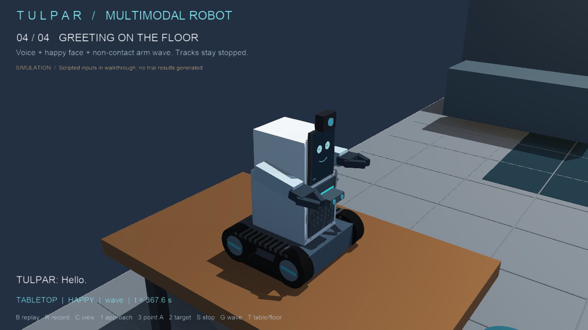

# TULPAR virtual demonstration

For the interactive, voice-controlled simulation, run **START-TULPAR.cmd** or open
**worlds/tulpar_demo.wbt**. To run the scripted visual showcase separately, use
**START-TULPAR-SHOWCASE.cmd** or open **worlds/tulpar_showcase.wbt**; press **B** to
replay and **C** to change its viewpoint. See [the walkthrough guide](docs/showcase.md).

The real-time run exported a silent MP4 and a Webots interactive 3D animation under `outputs/`. The current MP4 has a black interval and is not ready for presentation. Open `outputs/TULPAR-walkthrough-interactive.html` with its CSS, W3D, and JSON companion files kept beside it. The run evidence and export sizes are recorded in [the walkthrough run record](docs/showcase-run.md).

This folder contains the new Webots simulation source for the TULPAR research prototype. It is separate from the report and its drawings.

The first scene represents a controlled university demonstration room. It includes a floor route, carpet test area, tabletop support, operator figure, two marked targets, and a 0.6 m tracked robot based on the assembly concept.

## Intended behaviour

- The operator speaks naturally; local speech recognition transcribes the utterance, and a local model answers aloud, selects a facial emotion, or proposes a move to a named scene target.
- Floor mode: requests such as `come to me`, `move to the purple marker`, `drive to the bench`, or `approach the potted plant` control the simulated tracked base. TULPAR can navigate only to the two markers, the bench, or the potted plant, which are registered and recognised scene objects.
- Tabletop mode: the tracks remain locked; speech, animated face expressions, and arm gestures remain available.
- Spoken phrases can also request a greeting wave or a supported expression. `switch to floor mode` and `switch to tabletop mode` reposition the simulated robot between its two placements.
- `stop` or `emergency stop` bypasses the language model and cancels pending dialogue. The emergency stop remains latched until the operator says `clear emergency stop`.
- The controller records command, mode, outcome, response timing, and channel-start timestamps in `logs/tulpar-events.jsonl`.
- The Webots console shows compact event lines with allowed decision details such as target, mode, and rejection reason. It does not print spoken transcripts or generated reply text.

The controller supports keyboard development controls and a local voice path. Microphone speech is transcribed by Vosk when `TULPAR_VOSK_MODEL` points to a local English model directory. Stop is checked on Vosk partial results for low-latency cancellation; safety commands, mode changes, greetings and direct emotion requests are handled through `core/command_policy.py`. Other speech is sent to a local dialogue model asynchronously; Webots' Speaker reads its short response aloud and the face and arms use its validated emotion. The selected backend can be Ollama or the llama.cpp OpenAI-compatible server. Copy `START-TULPAR.local.example.cmd` to `START-TULPAR.local.cmd` and edit it once to set your local voice model and dialogue backend; the launcher reads it automatically.

Natural-language requests to approach a named scene object are interpreted by the local dialogue model. For example, ask it to “move to the yellow marker”, “drive to the bench”, or “approach the potted plant.” The model can propose only a registered target (`target-A`, `target-B`, `scene-bench`, or `scene-plant`); the controller separately checks that the utterance explicitly requests movement, names that same target, the target is freshly visible in the robot camera, floor mode is active, and the emergency stop is clear. Navigation coordinates come from the corresponding Webots scene node, never from the language model. A vague request such as “go to that object” or an ambiguous request naming multiple objects does not trigger motion. The model never sends wheel or actuator values. Any spoken `stop` is handled immediately outside the model and invalidates pending model answers. Conversation context is kept in memory only; transcripts and replies are not written to the event log.

## Planned launch

Open `worlds/tulpar_demo.wbt` in Webots and run the simulation in real-time mode. The scene needs Webots R2025a or a compatible later release.

Voice examples:

- `TULPAR, go to the yellow marker.`
- `Could you come to me?`
- `Tell me what you can do.`
- `Say hello.` / `Show me happy.`
- `Switch to tabletop mode.` / `Switch to floor mode.`
- `Stop.` / `Emergency stop.` / `Clear emergency stop.`

Keys (development and test controls):

- `1` — approach the operator.
- `2` — approach the marker indicated by the simulated pointing pose (test control only; voice navigation asks for a named marker).
- `3` / `4` — set the simulated operator fingertip pose towards marker A / B; then press `2` to test camera-based selection.
- `S` — stop.
- `G` — greeting wave.
- `H`, `A`, `D`, `P`, `Y`, `W`, `O`, `I`, `N` — happy, angry, sad, surprised, sleepy, wink, love, thinking, neutral.
- `T` — switch between floor and tabletop modes.
- `E` — simulated emergency stop.
- `F` — toggle an invalid-range-sensor fault for the retry/stop check.
- `C` — cycle the side-on test view, room overview, overhead, and robot-following views.
- `5` — start the next planned technical trial (requires the listed placement mode).
- `6` / `7` — record the active trial as pass / fail after checking its stated outcome.

The scene is a software simulation. Floor, carpet, and tabletop friction are separate provisional contact settings that need pilot tuning; they are not measured material properties. The simulation does not establish physical braking distance, power consumption, or hardware safety.

For Windows microphone setup, run `SETUP-TULPAR-VOICE.ps1` once from PowerShell; it installs the optional voice packages, downloads the compact Vosk model into the ignored `voice-models/` folder, and creates a local launcher configuration without overwriting an existing one. Then start `START-TULPAR.cmd`. For local dialogue model setup and troubleshooting, see [`docs/voice-setup.md`](docs/voice-setup.md). Without a Vosk model directory, microphone input is disabled and keyboard controls remain available. Without the configured local model service, ordinary conversation reports an unavailable model; `stop` continues to be handled by the controller.

Approach to the operator requires a fresh camera recognition of the operator. The simulation then uses the operator's Webots world pose for navigation; that pose is simulator ground truth rather than a vision-model estimate. Marker selection uses Webots recognition labels and the image-space alignment between simulated shoulder and fingertip markers. Keys `3` and `4` move the virtual fingertip to create repeatable test poses; this is a simulation input, not real-world pointing detection or a learned vision model. If the operator, gesture markers, or targets are not visible, or alignment is ambiguous, the controller rejects the command instead of choosing a fixed target.

## Trial plan

`scenarios/technical-trials.csv` lists each of the 40 planned trials separately. Regenerate it with `python -m core.trial_protocol` after changing the allocation. It contains inputs only; results and timestamps must come from actual simulation runs. The 10 greeting trials are split evenly between tabletop and floor placement.

The controller writes completed outcomes to `logs/technical-trial-results.csv`. Start a trial with `5`; the robot is reset to the same floor or tabletop pose between trials. For stop trials, it begins approaching the operator so you can issue `stop` while the tracks are moving. Use `6` for pass or `7` for fail after observing the outcome. A pass is rejected until the scenario reaches its measured success condition. The CSV records the planned scenario and elapsed Webots simulation time; an unrun trial has no result row. Existing result rows are kept and the controller resumes at the first unrecorded trial ID.

For the full setup and per-trial procedure, see [`docs/simulation-runbook.md`](docs/simulation-runbook.md). Marking a trial as failed now cancels the current movement or wave before the result is saved.

The controller event log tags scenario events with the active trial ID. The marker-selection block alternates the expected target evenly between target A and target B; the trial prompt tells you which simulated pointing-pose key to use. After running trials, `python -m core.trial_analysis` prints counts, observed pass rates, target-selection accuracy, response-time summaries, and channel-start spreads from those files. Empty or unmeasured quantities stay unavailable; the analysis does not invent values. The greeting voice now starts with the face response, just before the first simulated arm movement.

