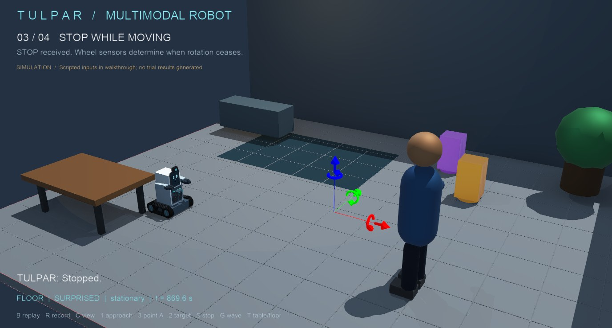
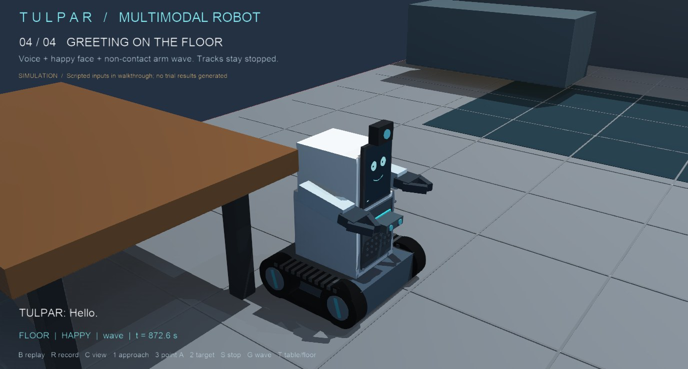
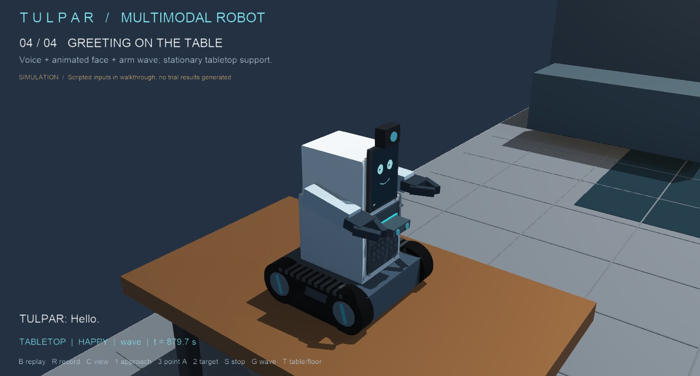
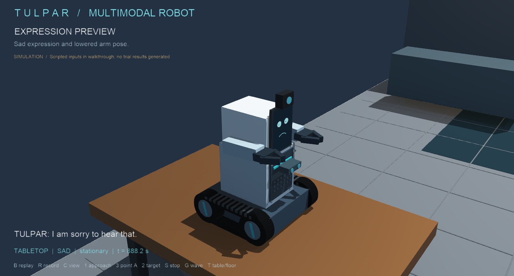

# TULPAR 3D walkthrough

Open `worlds/tulpar_showcase.wbt` in Webots R2025a, or run `START-TULPAR.cmd`.
The scene starts its walkthrough and records `outputs/TULPAR-walkthrough.mp4` automatically. Each fresh launch overwrites this preview. Click in the 3D view before using keys. Reload the world to replay if keyboard input is unavailable.

| Key | Action |
| --- | --- |
| B | Restart the walkthrough |
| R | Restart and record to `outputs/TULPAR-walkthrough.mp4` |
| C | Cycle external, overview, overhead and close follow cameras |
| 1 | Approach the operator |
| 3 / 4, then 2 | Point to target A / B, wait for a camera update, then approach |
| S | Stop the tracks |
| G | Non-contact greeting wave |
| T | Change floor / tabletop placement between trials |

The walkthrough demonstrates the four scenarios in `TULPAR (3).docx`: operator approach, indicated marked-target approach, stopping during motion, and greeting. Greeting is shown on the floor and the tabletop with the tracks stopped. Additional surprised, sad and happy expressions are a visual preview, not extra trial results. Object delivery and physical contact are excluded.

## Scene screenshots

These screenshots were captured from the Webots walkthrough. They illustrate the simulated stop response, the non-contact greeting in floor and tabletop modes, and two facial-expression previews. They are visual documentation of the scene, not results from the planned 40 technical trials. The coloured axes visible in the stop screenshot are Webots' editor selection gizmo.

### Stop response

The stop command has been received and the tracks are stationary.

### Greeting in floor mode

Spoken greeting, happy face, and a non-contact arm wave while the robot is on the floor.

### Greeting in tabletop mode

The same greeting behaviour with the drive inhibited in tabletop mode.

### Expression previews

Surprised face and raised arm pose.

Sad face and lowered arm pose.

The screenshots show representative visual states only. They do not establish command accuracy, response-time performance, or physical safety.

The room has a 0.5 m reference grid, a carpet patch, separate tabletop support, an operator figure and two coloured target fixtures. The model retains the reference design's tracked base, rectangular panelled body, smartphone face, webcam, paired arms and fixed claws. Added grille, panel fasteners, range-sensor housing, wheel hubs and tread cleats are conceptual details, not a fabrication specification.

Commands in the automatic walkthrough are scripted text passed through the command policy. Webots synthesises the robot's fixed spoken replies. Microphone recognition and local LLM dialogue require their separate configured dependencies; this demonstration does not claim to validate either. Target recognition uses Webots recognition objects and simulator positions, not the report's planned pose model. The mobile base uses four driven wheels under cosmetic tracks, not a deformable continuous belt simulation.

The controller records a range-based stand-off as `front_sensor_to_surface`. A navigation fallback is explicitly logged as `simulator_centre_distance`; these are different distance definitions and must not be combined as measurements. Simulated sensor readings and timings do not establish hardware stopping performance.

The walkthrough does not populate the 40-trial results CSV. The existing trial controls remain separate. Geometry, friction, masses and joint limits remain simulation assumptions requiring hardware validation.

Scene snapshots are written to `logs/showcase`. Rendering needs to be enabled. Close camera/display overlays if they obscure the scene; the face is also mapped onto the robot's actual phone surface. Use the Webots speaker control to enable sound.

The automatic walkthrough also records an MP4 at `outputs/TULPAR-walkthrough.mp4` on launch. Generated videos and simulation logs are excluded from Git; the video remains on the computer that ran Webots. The committed preview image above is included for quick viewing on GitHub.
